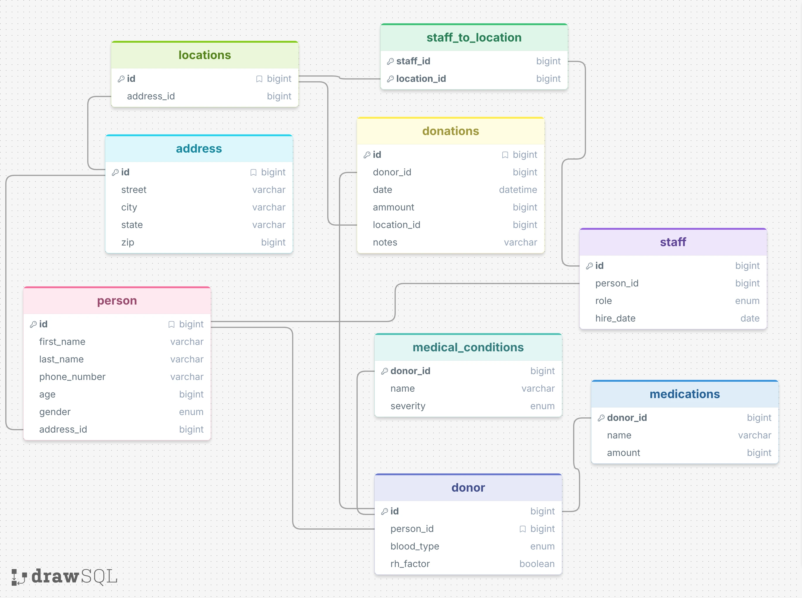

# Blood Bank Natural Language SQL

This project models blood-bank donors, staff, collection locations, and donations. It uses an OpenAI model to translate plain-English questions into SQLite queries and summarize the results.

## Schema



## Example that worked

**Question:** Which donors have given more than one donation?

**Prompt strategy:** Single-domain

**Generated SQL:**

```sql
SELECT p.first_name, p.last_name, COUNT(d.id) AS donation_count
FROM donor AS dr
JOIN person AS p ON p.id = dr.person_id
JOIN donations AS d ON d.donor_id = dr.id
GROUP BY dr.id, p.first_name, p.last_name
HAVING COUNT(d.id) > 1;
```

**Result:** Avery Johnson (3 donations), Noah Williams (2), and Liam Wilson (2).

**Friendly response:** “The donors who have given more than one donation are Avery Johnson, Noah Williams, and Liam Wilson.”

## Example that was misleading

**Question:** What is the total amount donated by each donor?

**Prompt strategy:** Single-domain

**Generated SQL:**

```sql
SELECT p.first_name, p.last_name, SUM(d.amount) AS total_donated
FROM donor AS dr
JOIN person AS p ON p.id = dr.person_id
JOIN donations AS d ON d.donor_id = dr.id
GROUP BY dr.id, p.first_name, p.last_name;
```

The query returned numeric totals, such as Avery Johnson: `1440` and Noah Williams: `900`. The friendly response formatted these as `$1,440` and `$900`, even though the database has no currency field. The model added meaning that was not present in the query result.

## Prompting strategies

The program ran the same eight questions with zero-shot and single-domain prompting. Both strategies generated executable SQL for all eight questions in this run. The single-domain prompt includes an example blood-bank question and query. On the repeated-donations example, both strategies found the same three donors. In the total-amount example, single-domain prompting returned donor names, while zero-shot returned donor IDs; the single-domain friendly answer also made the unsupported currency assumption described above. These results show that a more informative answer can still introduce incorrect details.

Full results are available in [the zero-shot output](response_zero_shot_20261014_132117.json) and [the single-domain output](response_single_domain_20261014_132315.json).

## Project files

- [Application code](db_bot.py)
- [SQLite database](aidb.sqlite)
- [Additional example questions](example_questions.md) — ten questions for further experiments.
- [Schema definition](setup.sql) and [sample data](setupData.sql)
